# VirtuSpace

## Smart Collaboration Platform for students, faculty and innovators

## Problem Statement

- Finding a project in an interested domain to work on, has become a tedious process for students and project seekers.
- Building a capable and innovative team for an ideated project is also a mind-numbing task for researchers, faculties and companies.
- VirtuSpace connects students, faculty, and innovators to explore projects, form teams, and collaborate.

## Features

- Students can update their profile in which they can mention their domain of interest.
- Students can view the teachers/professors profile and connect with them.
- The teacher/professor can either personally message or create a group where he/she can interact with all students.
- There is a filter option present where we can filter the person based on their field of interest.  

## Technologies Used

- Flutter: Framework for the VirtuSpace Android app.
- Dart: Object-oriented programming language used in Flutter development.
- Firebase: Backend-as-a-Service platform for authentication, real-time database, and push notifications.

## Android build

The Android application ID is `com.virtuspace.app` and its minimum Android SDK
version is 23. Android builds use JDK 17 (required by Android Gradle Plugin
7.4.2). Firebase initialization reads the Android client configuration from
`android/app/google-services.json`.

## User Interface

<div align="center">
    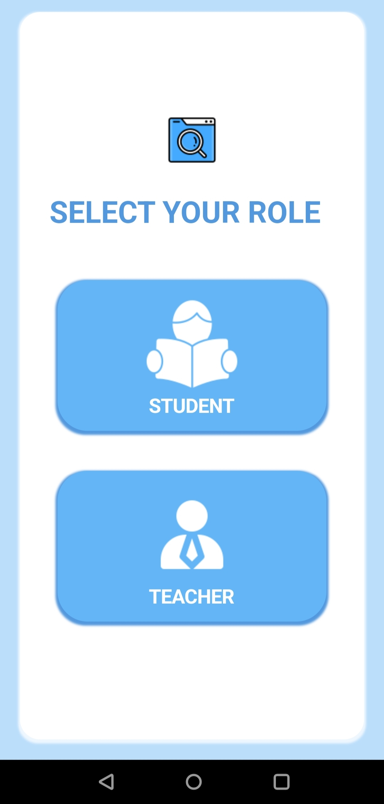
    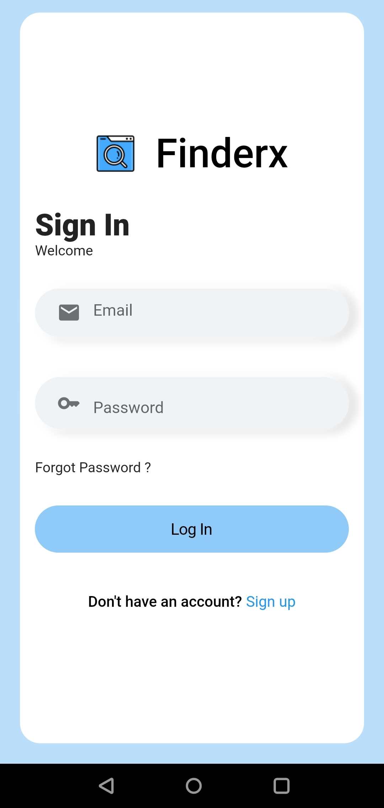
    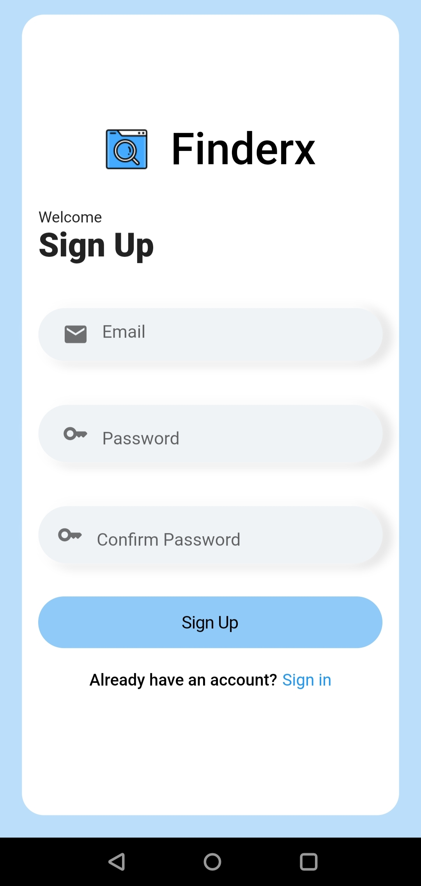
</div>
<br><br><br><br>
<div align="center">
    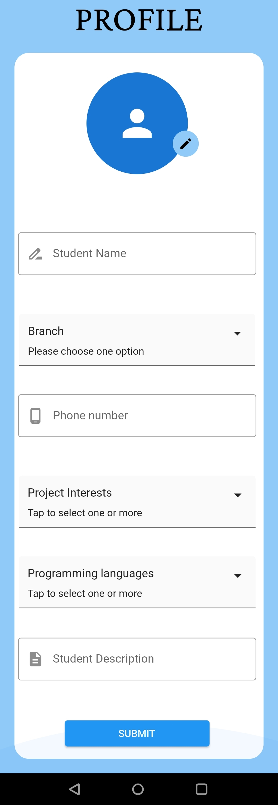
    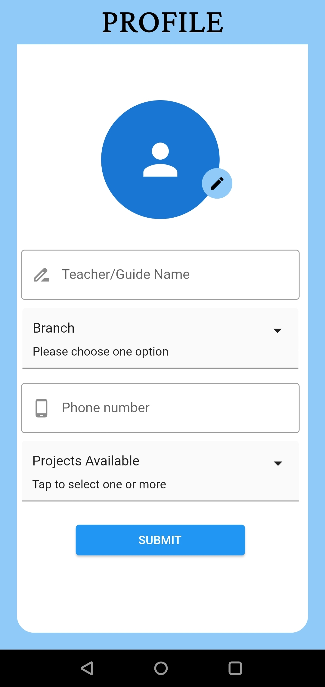
    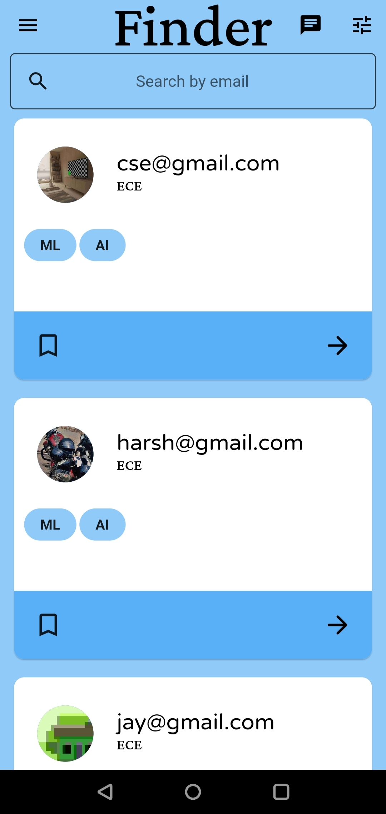
</div>
<br><br><br><br>
<div align="center">
    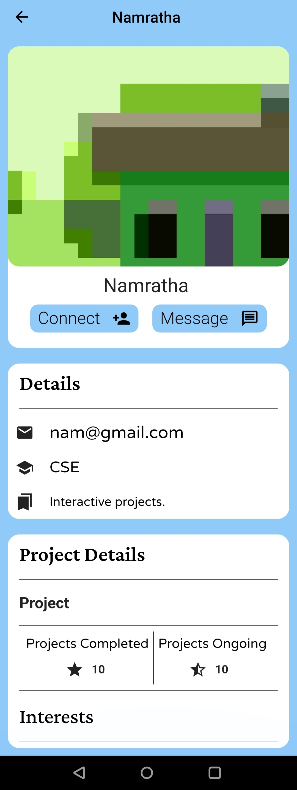
    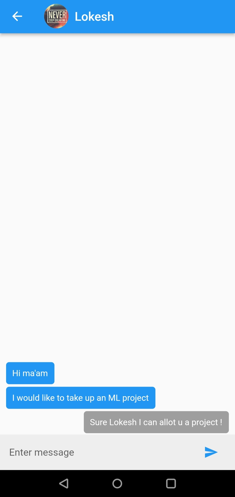
    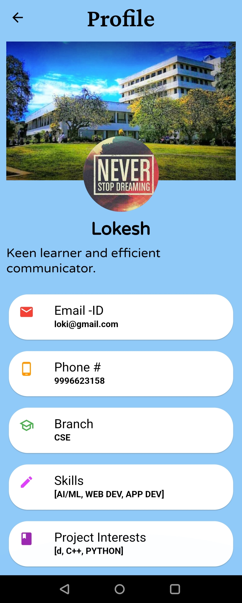
</div>
<br><br><br><br>
<div align="center">
    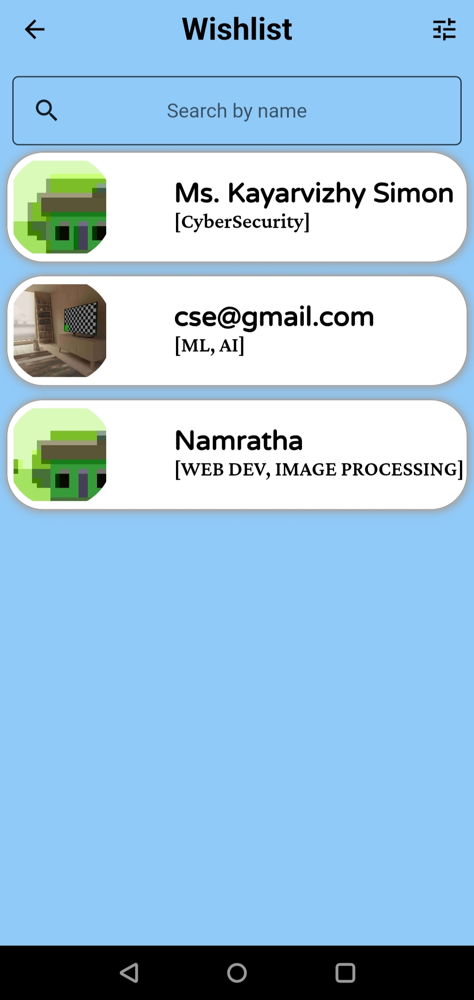
    
 
</div>

### Firebase Database
<br>
<div align="center">
    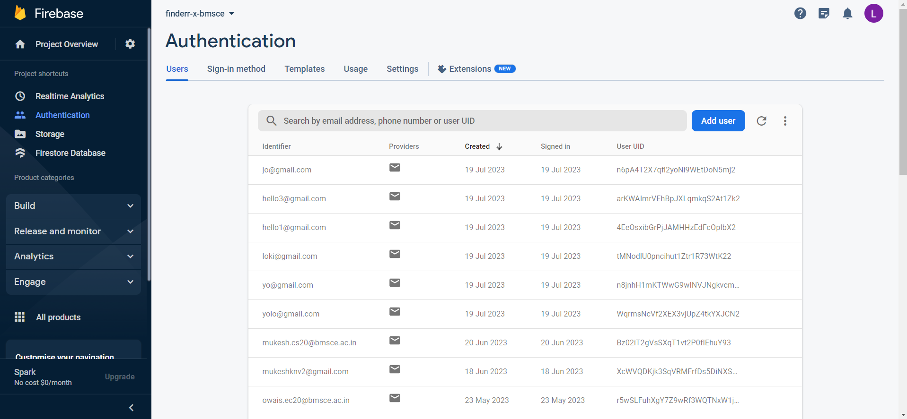
   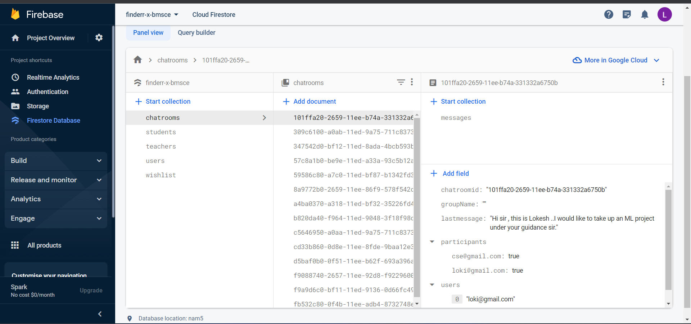
</div>

## Firestore Schema

The app uses Firebase Auth UIDs as profile document IDs. Collections are read and
written through their feature repositories under `lib/features/`.

- `users/{uid}` stores role (`student`, `teacher`, or `innovator`), name, bio,
  photo URL, department, skills, interests, domains, certification URLs,
  college, preferred project role, experience level, availability, preferred
  working hours, follower counts, resume URL, and creation time. Follower relationships are
  under `followers/{followerUid}` and `following/{targetUid}`. Idempotent
  interest requests are under `interests/{targetUid}`; device tokens are under
  `fcmTokens/{token}`.
- `notifications/{id}` stores recipient/sender UIDs, type, optional reference,
  creation time, and read state. A Firestore create trigger sends an FCM push
  to the recipient's registered devices.
- `posts/{id}` and `projects/{id}` are owned by `authorUid` and `ownerUid`.
  Projects also store required skills and accepted collaborator UIDs in
  `teamUids`.
  Post images are stored beneath `posts/{authorUid}/{postId}/`.
- `batches/{id}` stores a teacher, at least four student UIDs, a project, a
  three-month date range, and status. A student's
  `users/{uid}/activeBatch/current` claim prevents overlapping active batches.
  Shared tasks and batch chat messages are stored under
  `batches/{id}/tasks/{taskId}` and `batches/{id}/messages/{messageId}`.
- `facultyStats/{teacherUid}` contains active student UIDs for directory counts.
  Each project stores task totals updated by a task-write Cloud Function, so
  Project Explore can show progress without exposing private task documents.
  Batch creation runs through the authenticated `createBatch` callable; it
  transactionally reserves every student and links the teacher's project.

Deploy `firestore.rules` with the Firebase CLI when deploying the app. Existing
documents in the previous `students` and `teachers` collections are not migrated
automatically; backfill them into `users/{uid}` with this schema before rollout.

## Account and notification security

Client-created profiles may only use the `student` or `innovator` role. Teacher
profiles are created by the authenticated `registerTeacher` callable after it
checks the `FACULTY_INVITE_CODE` Firebase secret. Configure that secret before
deploying Functions:

```shell
firebase functions:secrets:set FACULTY_INVITE_CODE
```

Sign-up sends an email verification link. Unverified users can browse, but
Firestore rules and the batch/request callables reject creating posts, projects,
batches, follows, interests, and collaboration requests until the email is
verified. The app banner can resend the link and refresh the verification
status.

Clients cannot create `/notifications` documents. Follow and interest events
create notifications through Firestore triggers; batch invitations are created
by `createBatch`, and task notifications by a Firestore trigger. The existing
notification-created trigger continues to deliver FCM pushes. Notification
security and registration helper tests run with `npm test` in `functions/`.

Resumes and certification documents are uploaded beneath
`profiles/{uid}/resume/` and `profiles/{uid}/certifications/` in Firebase
Storage. Resumes are PDF-only; certifications accept PDF, PNG, or JPEG files.
Deploy `storage.rules` to restrict uploads to the owning account.

Deploy the Firebase resources, indexes, notification function, and hourly batch
expiry scheduler from this
directory with `firebase deploy --only firestore:rules,firestore:indexes,storage,functions`.
The function runtime is Node.js 22; run `npm install` in `functions/` before
deploying. Enable Firebase Cloud Messaging and configure Android
`google-services.json` for push delivery.
The app registers/removes each signed-in device's FCM token, shows foreground
pushes, and opens the live notifications list when a push is tapped.

Posts support captions, update/certification types, and up to six JPG, PNG, or
WebP images. Home feeds load followed-user posts in pages; profile pages show
the author's posts in a grid. Firestore composite indexes are included in
`firestore.indexes.json`.

## AI features

Smart Team Matching runs in the authenticated `suggestTeammates` Cloud
Function. It is a deterministic scoring engine, not a machine-learning model.
It maps project and profile skills to frontend, backend, mobile, data/AI,
design, and hardware categories; scores required skill coverage (40%), team
complementarity (25%), shared interests (15%), role fit (10%), and experience
plus availability (10%); and returns explanations with each score. It excludes
the signed-in student and existing project/batch members. Suggestions are
limited to projects the caller owns, belongs to, or can explore while open.

Students can edit matching fields from their profile and filter suggestions by
skill, college, experience, and current availability. `inviteTeammate` creates
an authenticated, idempotent record in `collaborationRequests/{requestId}` and
notifies the invited student. The recipient can accept or reject through
`respondToCollaborationRequest`; acceptance adds them to the project's
`teamUids` (and adds a non-owner requester who initiated the collaboration)
and notifies the requester. It does not silently enroll them in an existing
faculty batch.

The matching engine has unit tests in `functions/matching.test.js`; run them
with `npm test` from the `functions/` directory.

The VirtuSpace Assistant uses the `chatbot` callable as a server-side proxy to
OpenAI. No provider key is bundled in the app. Before deploying Functions,
configure the Firebase secret and deploy Functions:

```shell
firebase functions:secrets:set OPENAI_API_KEY
firebase deploy --only functions
```

Chat history is stored under each user's
`users/{uid}/aiChatMessages/` path and is readable only by that user. The
callable rate-limits each user to 20 requests per hour.
