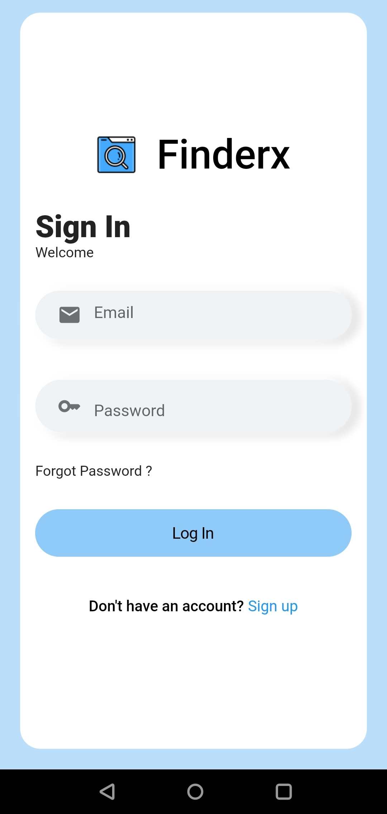
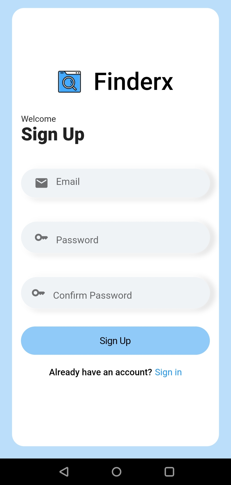
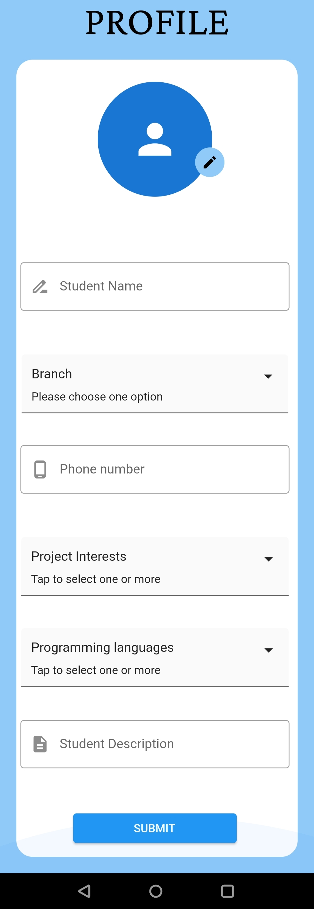
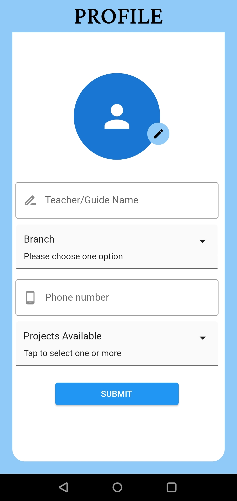
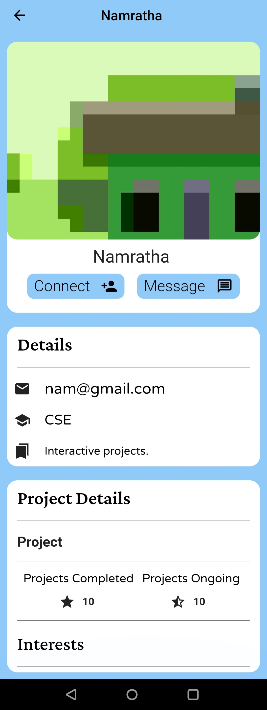
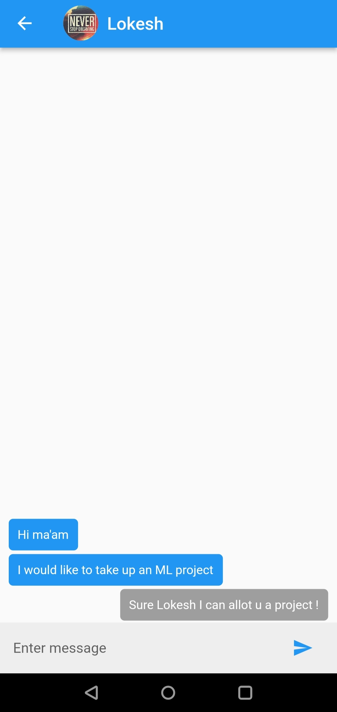
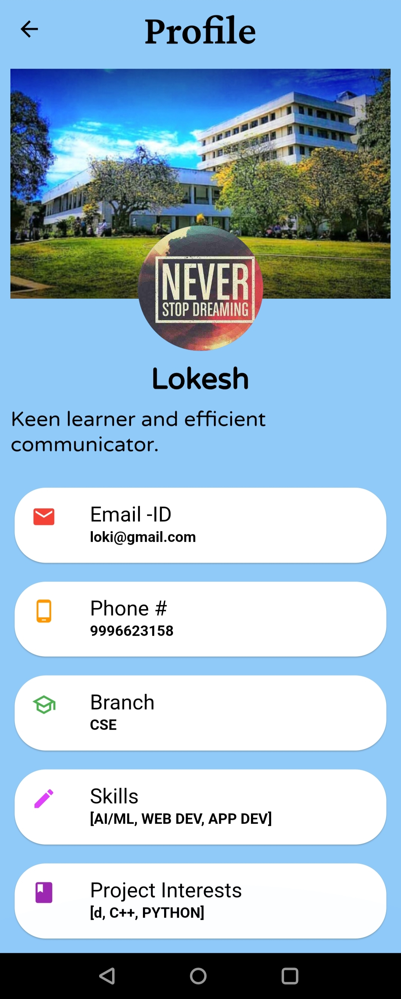
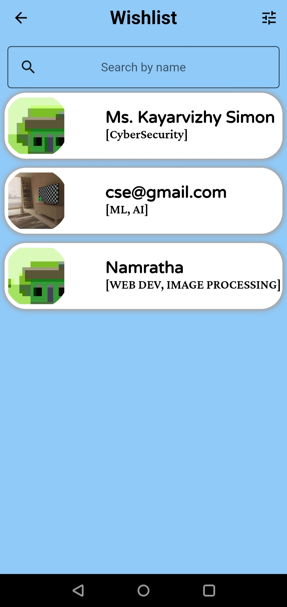
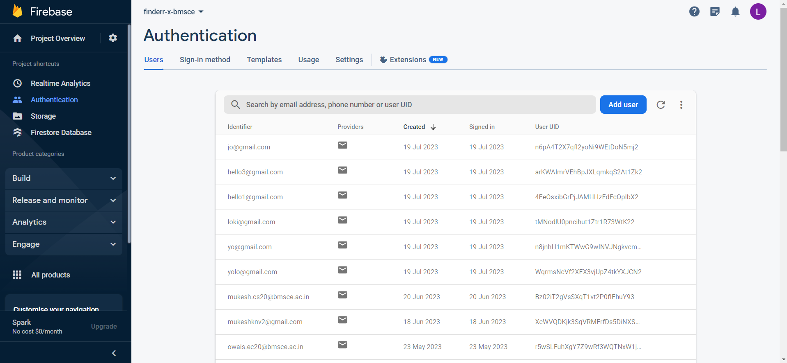
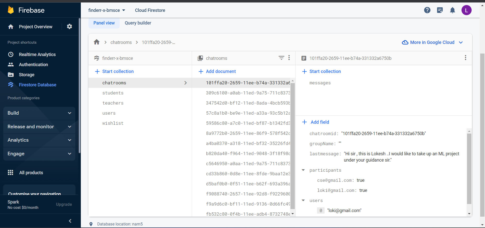

# Finder X BMSCE 📱

## Problem Statement

- Finding a project in an interested domain to work on, has become a tedious process for students and project seekers.
- Building a capable and innovative team for an ideated project is also a mind-numbing task for researchers, faculties and companies.
- FinderX is a minimal, user-friendly solution that bridges the gap between these two parties by offering them a platform for seeking and communicating with each other

## Features

- Students can update their profile in which they can mention their domain of interest.
- Students can view the teachers/professors profile and connect with them.
- The teacher/professor can either personally message or create a group where he/she can interact with all students.
- There is a filter option present where we can filter the person based on their field of interest.  

## Technologies Used

- Flutter : Cross-platform framework for building mobile applications.
- Dart: Object-oriented programming language used in Flutter development.
- Firebase: Backend-as-a-Service platform for authentication, real-time database, and push notifications.

## User Interface

<div align="center">
    
    
    
</div>
<br><br><br><br>
<div align="center">
    
    
    
</div>
<br><br><br><br>
<div align="center">
    
    
    
</div>
<br><br><br><br>
<div align="center">
    
    
 
</div>

### Firebase Database
<br>
<div align="center">
    
   
</div>

## Firestore Schema

The app uses Firebase Auth UIDs as profile document IDs. Collections are read and
written through their feature repositories under `lib/features/`.

- `users/{uid}` stores role (`student`, `teacher`, or `innovator`), name, bio,
  photo URL, department, skills, interests, domains, certification URLs,
  follower counts, resume URL, and creation time. Follower relationships are
  under `followers/{followerUid}` and `following/{targetUid}`. Idempotent
  interest requests are under `interests/{targetUid}`; device tokens are under
  `fcmTokens/{token}`.
- `notifications/{id}` stores recipient/sender UIDs, type, optional reference,
  creation time, and read state. A Firestore create trigger sends an FCM push
  to the recipient's registered devices.
- `posts/{id}` and `projects/{id}` are owned by `authorUid` and `ownerUid`.
  Post images are stored beneath `posts/{authorUid}/{postId}/`.
- `batches/{id}` stores a teacher, at least four student UIDs, a project, a
  three-month date range, and status. A student's
  `users/{uid}/activeBatch/current` claim prevents overlapping active batches.
  Shared tasks and batch chat messages are stored under
  `batches/{id}/tasks/{taskId}` and `batches/{id}/messages/{messageId}`.
- `facultyStats/{teacherUid}` contains active student UIDs for directory counts.
  Each project stores task totals updated by a task-write Cloud Function, so
  Project Explore can show progress without exposing private task documents.
  Batch creation runs through the authenticated `createBatch` callable; it
  transactionally reserves every student and links the teacher's project.

Deploy `firestore.rules` with the Firebase CLI when deploying the app. Existing
documents in the previous `students` and `teachers` collections are not migrated
automatically; backfill them into `users/{uid}` with this schema before rollout.

Resumes and certification documents are uploaded beneath
`profiles/{uid}/resume/` and `profiles/{uid}/certifications/` in Firebase
Storage. Resumes are PDF-only; certifications accept PDF, PNG, or JPEG files.
Deploy `storage.rules` to restrict uploads to the owning account.

Deploy the Firebase resources, indexes, notification function, and hourly batch
expiry scheduler from this
directory with `firebase deploy --only firestore:rules,firestore:indexes,storage,functions`.
The function runtime is Node.js 22; run `npm install` in `functions/` before
deploying. Enable Firebase Cloud Messaging and configure Android
`google-services.json` and the iOS APNs key/capabilities for push delivery.
The app registers/removes each signed-in device's FCM token, shows foreground
pushes, and opens the live notifications list when a push is tapped.

Posts support captions, update/certification types, and up to six JPG, PNG, or
WebP images. Home feeds load followed-user posts in pages; profile pages show
the author's posts in a grid. Firestore composite indexes are included in
`firestore.indexes.json`.

## AI features

Teammate scoring runs in the `suggestTeammates` Cloud Function and maps profile
skills to frontend, backend, mobile, data/AI, design, and hardware categories.
Suggestions are scoped to a project the caller owns or an active batch they
belong to. `inviteTeammate` sends an idempotent project/batch collaboration
notification; it does not add members directly to an existing batch.

The FinderX chatbot uses the `chatbot` callable as a server-side proxy to
OpenAI. No provider key is bundled in the app. Before deploying Functions,
configure the Firebase secret and deploy Functions:

```shell
firebase functions:secrets:set OPENAI_API_KEY
firebase deploy --only functions
```

Chat history is stored under each user's
`users/{uid}/aiChatMessages/` path and is readable only by that user. The
callable rate-limits each user to 20 requests per hour. Matching scoring has
unit tests in `functions/matching.test.js`; run them with `npm test` from the
`functions/` directory.
